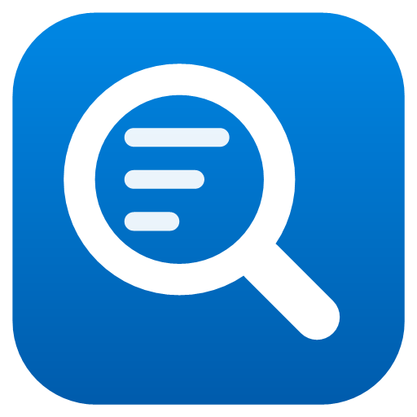

# ADO Lens for Azure DevOps — serwer MCP dla Claude'a

[](https://github.com/willowdev-code/ado-lens/actions/workflows/ci.yml)

[English](README.md) | **Polski**

Daje Claude'owi (Desktop i Code) zwięzły, świadomy procesu dostęp do Azure DevOps: work itemy, tablice, wiki, Git i TFVC,
pipeline'y. Dla deweloperów i Product Ownerów: **tryb PO** pomaga pisać i sprawdzać pracę, **tryb dev** dokłada kod,
pull requesty i pipeline'y. Odpowiedzi to krótki tekst zamiast surowego JSON-a, więc work item kosztuje kilkaset tokenów,
a nie tysiące. Zmiany między wersjami: [CHANGELOG.md](CHANGELOG.md). Plan rozwoju: [docs/PLAN.md](docs/PLAN.md).

© 2026 WillowDev. Udostępnione na [licencji MIT](LICENSE). Projekt niezależny, niezwiązany z Microsoftem;
Azure DevOps jest znakiem towarowym Microsoftu.

> Stan: **0.x — w budowie.** Działają połączenia, rejestracja w Claude, lokalna struktura work itemów, work itemy,
> sprinty, tablice, backlogi, wiki, śledzenie pracy do kodu i wdrożeń, pull requesty, pipeline'y oraz instalacja
> jedną linijką z kreatorem i aktualizacjami.

## Czym się różni

- **Zna proces każdego projektu.** Typy według poziomu backlogu (portfolio / wymaganie / zadanie / błąd), prawdziwe
  stany i przejścia, pola wymagane, dozwolone wartości i pola własne trafiają z Azure DevOps do lokalnej kopii i są
  sprawdzane *przed* zapisem — niezależnie od tego, jak proces nazywa typy (User Story, Product Backlog Item,
  Requirement albo własne nazwy firmy).
- **Małe odpowiedzi.** Bez pustych pól, osoby jako imię i nazwisko, opisy jako markdown, linki w skrócie
  (`code (2): changeset 523 "Fix …"; build 213864`), techniczne pola tablic ukryte.
- **Bezpieczne zmiany wielu elementów.** Zmiana więcej niż kilku work itemów zwraca najpierw podgląd; zapis następuje
  dopiero po powtórzeniu wywołania z tokenem z podglądu.
- **Git i TFVC** w tym samym projekcie, kilka organizacji obok siebie.
- **Niczego nie ogranicza:** ADO Lens może to, na co pozwala twój PAT i konto.

## Instalacja

**Najprościej — jedna linijka.** W zwykłym oknie PowerShella (nie jako administrator) wklej:

```powershell
irm https://raw.githubusercontent.com/willowdev-code/ado-lens/main/get.ps1 | iex
```

Polecenie pobiera najnowsze wydanie, porównuje jego SHA-256 z sumą publikowaną przez GitHuba i uruchamia instalator.
Plik pobrany w ten sposób nie jest oznaczany jako „z internetu”, więc Windows SmartScreen nie zatrzymuje (jeszcze
niepodpisanego) programu. Na komputerze nie trzeba niczego więcej, nawet .NET.

Paczki instalacyjnej nie ma w repozytorium (`dist\` jest pomijany przez `.gitignore`). Inne drogi:

**Z kreatorem (instalator EXE).** Pobierz `ado-lens-setup-X.Y.Z.exe` z zakładki **Releases** i uruchom — bez uprawnień
administratora. Pyta o link do Azure DevOps i PAT (sprawdzane, zanim cokolwiek się zainstaluje), kto używa (Product
Owner / programista / wszystko) oraz — gdy znajdzie etapy release'ów i gałęzie — jak nazywacie środowiska (dla ciebie
albo całego zespołu); instaluje skille i rejestruje ADO Lens w Claudzie. Język (polski lub angielski) wybierasz na
starcie i zostaje też dla ustawień; aktualizacja pomija pytania. Dopóki
program nie jest podpisany, Windows SmartScreen może przy pliku pobranym przeglądarką pokazać „System Windows ochronił
ten komputer”: *Więcej informacji → Uruchom mimo to* (albo użyj instalacji jedną linijką powyżej, która tego unika).

Po instalacji w menu Start jest folder **ADO Lens**: *ustawienia* (menu: tryb, środowiska — zmiana, dodanie, usunięcie,
dla ciebie lub zespołu —, dodanie lub usunięcie połączenia, status, język), *status* (czy wszystko działa) i skille dla Claude Desktop; `adolens` działa w każdym nowym terminalu.
Odinstalowanie: *Ustawienia → Aplikacje → ADO Lens* (albo z menu Start) — usuwa program, jego rejestracje w Claudzie
i skille, i pyta, czy usunąć też zapisane PAT-y i ustawienia (domyślnie zostają).

**Tylko Claude Desktop (rozszerzenie).** `ado-lens-X.Y.Z.mcpb` z **Releases**: otwórz go w Claude Desktop (albo
przeciągnij do *Settings → Extensions*) i wpisz link do projektu oraz PAT, który Claude Desktop trzyma w bezpiecznym
magazynie systemu. Nie konfiguruje Claude Code ani skilli; gdy ADO Lens jest już zalogowany na tym komputerze, zostaw
pola puste.

**A. Z gotowej paczki** — na maszynie docelowej nie trzeba niczego instalować, nawet .NET.

1. Pobierz `ado-lens-X.Y.Z.zip` z zakładki **Releases** tego repozytorium.
2. Rozpakuj i w zwykłym PowerShellu (nie jako administrator) uruchom:

```powershell
powershell -ExecutionPolicy Bypass -File .\ado-lens\install.ps1
```

**B. Z kodu źródłowego** — wymaga .NET 9 SDK.

```powershell
git clone https://github.com/willowdev-code/ado-lens.git C:\Dev\ado-lens
cd C:\Dev\ado-lens
.\pack.ps1                     # tworzy dist\ado-lens\ i dist\ado-lens-X.Y.Z.zip (+ .sha256)
powershell -ExecutionPolicy Bypass -File .\dist\ado-lens\install.ps1
```

Instalator działa w sześciu krokach, każde pytanie ma odpowiedź domyślną (Enter ją przyjmuje):

1. sprawdza, czy rejestracja w Claude musi się zmienić,
2. kopiuje program do `%LOCALAPPDATA%\Programs\ADO Lens` (bez uprawnień administratora),
3. pyta o adres Azure DevOps (wklej dowolny link z przeglądarki — organizacja i projekt zostaną z niego wyciągnięte),
   PAT (wpisywany niewidocznie) i domyślny projekt (wybierany z listy),
4. pyta, kto będzie używał narzędzia (Product Owner / programista / wszystko) i przez jakie środowiska przechodzi kod:
   znajduje etapy release'ów i gałęzie, proponuje nazwy (dev → DEV, staging → UAT, master → PROD) i zapisuje je dla
   ciebie albo — gdy się zgodzisz — dla całego zespołu na stronie wiki projektu „ADO Lens” (później to samo robi
   `adolens setup`),
5. instaluje skille: do `%USERPROFILE%\.claude\skills` dla Claude Code oraz jako paczki ZIP w folderze
   `skills-for-claude-desktop` do wgrania w Claude Desktop (Ustawienia → Capabilities → Skills),
6. rejestruje serwer `ado-lens` w Claude Desktop i Claude Code.

Na polskim Windowsie pytania są po polsku, w innym przypadku po angielsku.
Jeśli rejestracja musi się zmienić, a Claude Desktop działa, instalator prosi o zamknięcie Claude'a, czeka i uruchamia go
ponownie. Uruchomienie `install.ps1` z nowszej paczki aktualizuje program i zostawia ustawienia, PAT-y i metadane;
`adolens.exe` używany przez otwartą sesję dostaje nazwę `*.old`, więc ta sesja działa dalej.

Przydatne parametry:

```powershell
.\install.ps1 -Organization https://dev.azure.com/contoso/Demo   # bez pytania o adres
.\install.ps1 -Mode dev                                           # po (domyślny) | dev | full
.\install.ps1 -DesktopOnly | -CodeOnly | -NoRegister | -NoRestart
```

**Aktualizacja.** Serwer sprawdza GitHuba najwyżej raz dziennie, w tle. Gdy jest nowsza wersja, Claude wspomni o niej raz
w sesji; wystarczy powiedzieć „zaktualizuj ADO Lens”, a `ado_upgrade` pobierze ją, sprawdzi SHA-256 i uruchomi jej
instalator w osobnym oknie. Z terminala: `adolens upgrade` pokazuje, co nowego, `adolens upgrade --install` instaluje
(`--pre` uwzględnia wydania testowe). Ustawienia, PAT-y i metadane zostają; Claude może być otwarty.

Deinstalacja (instalacja z ZIP-a i jedną linijką): `uninstall.ps1` w folderze instalacji (usuwa rejestracje i skille tej instalacji w Claude, pyta o zapisane
PAT-y i dane lokalne).

### PAT

Utwórz go na `https://dev.azure.com/<organizacja>/_usersSettings/tokens` dla jednej organizacji, z zakresami, których
ma używać Claude, i krótką ważnością. Proponowane dla PO: Work Items (Read & write), Code (Read), Wiki (Read & write),
Build (Read), Release (Read), Test Management (Read & write), Project and Team (Read), Identity (Read). PAT tylko do
odczytu sprawia, że cały serwer tylko czyta.

PAT trafia do **Menedżera poświadczeń Windows** (`ado-lens:<połączenie>`), nigdy do pliku ani do konfiguracji Claude'a.
Bez zapisanego PAT używane są zmienne `ADOLENS_PAT_<POŁĄCZENIE>`, a potem `AZURE_DEVOPS_PAT`. Szczegóły:
[SECURITY.md](SECURITY.md).

## Konfiguracja po instalacji

```powershell
adolens login --org https://dev.azure.com/fabrikam/Shop --connection fabrikam   # kolejna organizacja
adolens connections                          # lista (* = domyślne)
adolens config                               # pokaż ustawienia
adolens config --connection contoso --project Demo --team "Demo Team"
adolens config --default-connection fabrikam
adolens config --mode dev                    # po | dev | full
adolens config --add-toolset pipelines       # dodatkowa grupa narzędzi ponad tryb
adolens config --tool-loading auto           # auto | demand | all: kiedy ładować grupy narzędzi
adolens config --confirm-above 3             # zmiany większej liczby elementów najpierw jako podgląd (0: zawsze)
adolens config --usage-log false
adolens config --show-tokens true            # każda odpowiedź kończy się [~N tokens]
adolens config --connection contoso --env staging=UAT --env master=PROD   # co znaczą gałęzie (dla ado_trace)
```

**Środowiska.** Azure DevOps nie wie, że gałąź `staging` to UAT. Zmapuj swój przepływ dla połączenia — tyle kroków, ile
ma, w jego kolejności — `--env klucz=etykieta`, `--remove-env klucz`. Kluczem jest gałąź (`dev`, `staging`; dla TFVC
ostatnia część ścieżki gałęzi, np. `Main`), definicja release'u albo jeden etap release'u jako `"Definicja/Etap"` —
przydatne, gdy jeden etap wdraża na dwa środowiska naraz:

```powershell
adolens config --connection contoso --env dev="DEV (sbx01)" --env staging="UAT (sbx03)" --env master=PROD
adolens config --connection fabrikam --env "Main-Deploy/Stage 1=UAT + SCM"
```

Wtedy `ado_trace` wypisuje etapy w tej kolejności z ich etykietami („UAT (sbx03): YES”), a dla Gita sprawdza też, czy
praca jest scalona do każdej zmapowanej gałęzi, nawet gdy żaden pipeline jej nie wdraża.

**Kilka repozytoriów.** Ta sama nazwa gałęzi może znaczyć co innego w różnych repozytoriach — albo nic (biblioteka
scalana prosto do `master`). Klucz `Repozytorium:gałąź` należy do jednego repozytorium; repozytorium z własnymi kluczami
używa tylko ich, pozostałe — zwykłych kluczy gałęzi. Instalator i `adolens setup` nazywają tak gałęzie, gdy projekt ma
więcej niż jedno aktywne repozytorium, i pomijają gałęzie robocze (`000000_TestBranch`, `123456_…`):

```powershell
adolens config --connection contoso --env "ERP:dev=DEV (sbx01)" --env "ERP:staging=UAT (sbx03)" --env "ERP:master=PROD" --env "Common:master=PROD"
```

**Kod w innym projekcie.** Gdy work itemy są w jednym projekcie, a kod, pull requesty i pipeline'y w innym, ustaw to
raz: `adolens config --connection contoso --code-project ERP` (albo poproś Claude'a: `ado_settings codeProject=ERP`).
Wtedy `ado_file`, `ado_search` (kod), `ado_pr`, `ado_pipeline` i `ado_label` szukają tam.

**Jedna mapa dla całego zespołu.** Mapa może mieszkać w samym Azure DevOps: strona „ADO Lens” w wiki projektu z tabelą
w dwóch kolumnach (gałąź albo etap release'u | środowisko), w kolejności przepływu. Każdy, kto używa ADO Lens w projekcie,
ją czyta, więc Product Ownerzy niczego nie konfigurują; lokalna mapa (`--env`) nadpisuje ją dla jednej osoby. Zapisują
ją instalator, `adolens setup` i `ado_settings scope=team` (z wersją strony, żeby nie zgubić równoległej zmiany),
a tabelę można też poprawić ręcznie.

Nikt nie musi tego ustawiać zawczasu: gdy mapy nie ma, `ado_trace` kończy się krótką notą SETUP z wykrytym przepływem
(etapy release'ów wdrażane w ostatnim półroczu i stałe gałęzie, z pierwszym przypuszczeniem typu dev → DEV,
staging → UAT, master → PROD). Claude raz pyta użytkownika, jak nazywa te środowiska, i zapisuje odpowiedź przez
`ado_settings` — na stałe, dla niego albo (po zgodzie) dla zespołu.

Ustawienia siedzą w `%LOCALAPPDATA%\ado-lens\adolens.json` (bez sekretów) — można je też edytować ręcznie.

### Tryby i grupy narzędzi

Każda definicja narzędzia kosztuje tokeny w każdej sesji, więc sesja startuje z małym rdzeniem (ok. 1,5 tys. tokenów),
a Claude dociąga grupę przez `ado_tools enable=<grupa>`, gdy rozmowa jej potrzebuje — pytanie o sprint ładuje `boards`,
nowa historyjka `write`. Skille i prompty same ładują to, czego używają. Tryb wybiera tylko, które grupy wolno załadować;
nigdy nie jest uprawnieniem (o tym decyduje PAT).

| Grupa | Narzędzia | po | dev | full |
|---|---|:-:|:-:|:-:|
| `core` (zawsze) | `ado_status`, `ado_settings`, `ado_upgrade`, `ado_tools`, `ado_work_item`, `ado_query`, `ado_search`, `ado_trace` | ✓ | ✓ | ✓ |
| `write` | `ado_fields`, `ado_create`, `ado_update`, `ado_comment`, `ado_link`, `ado_create_tree`, `ado_undo` | ✓ | ✓ | ✓ |
| `boards` | `ado_sprint`, `ado_board`, `ado_backlog`, `ado_my_day`, `ado_health`, `ado_metrics`, `ado_release_notes` | ✓ | – | ✓ |
| `wiki` | `ado_wiki`, `ado_wiki_write` | ✓ | ✓ | ✓ |
| `code` | `ado_changes`, `ado_file`, `ado_label`, `ado_review`, `ado_attachments` | ✓ | ✓ | ✓ |
| `tests` | `ado_tests`, `ado_test_create` | ✓ | – | ✓ |
| `recipes` | `ado_recipe` | ✓ | ✓ | ✓ |
| `pr` | `ado_pr`, `ado_pr_update` | – | ✓ | ✓ |
| `pipelines` | `ado_pipeline`, `ado_pipeline_run` | – | ✓ | ✓ |

`adolens config --add-toolset <grupa>` dopuszcza jeszcze jedną grupę ponad tryb. Kiedy ładować grupy, ustawia
`adolens config --tool-loading` (albo *Narzędzia na start* w menu ustawień):

- `auto` (domyślnie): na żądanie w Claude Code, który przyjmuje nowe narzędzia w trakcie rozmowy; w innych klientach,
  także w Claude Desktop, wszystkie grupy trybu od startu (ok. 6–7 tys. tokenów), żeby niczego tam nie brakowało;
- `demand`: na żądanie w każdym kliencie (ok. 1,3 tys. tokenów na start) — dla klienta, o którym wiadomo, że przyjmuje nowe narzędzia;
- `all`: wszystkie grupy trybu od startu wszędzie.

## Mapa narzędzi

Na co odpowiada każde narzędzie MCP, kiedy Claude powinien po nie sięgnąć i jaki jest odpowiednik w CLI.

| Narzędzie | Odpowiada na | Kiedy | CLI |
|---|---|---|---|
| `ado_status` | wersja, połączenie, zalogowany użytkownik, źródło PAT, wiek metadanych | sprawdzenie konfiguracji | `adolens status` |
| `ado_settings` | ustawienia połączenia i używany przepływ środowisk (lokalny albo ze strony wiki zespołu) lub wykryty; z `environments` zapisuje na stałe, co znaczą gałęzie i etapy release'ów, w kolejności przepływu (`dev=DEV (sbx01); staging=UAT (sbx03); master=PROD`); `scope=team` zapisuje stronę wiki | `ado_trace` pyta o to raz (SETUP), użytkownik odpowiada słowami | `adolens setup` |
| `ado_upgrade` | czy jest nowsza wersja ADO Lens; `install=true` pobiera ją (z kontrolą SHA-256) i uruchamia jej instalator | gdy użytkownik prosi o aktualizację | `adolens upgrade --install` |
| `ado_fields` | typy według poziomu backlogu; dla typu: stany, przejścia, pola, wymagalność, dozwolone wartości; dla pola: gdzie jest używane i jakie ma wartości; zmiany struktury w czasie | przed zapisem pól albo WIQL; „jakie pola ma Bug”, „co się zmieniło w procesie w tym miesiącu” | `adolens fields --type Bug`, `adolens fields --field Severity`, `adolens fields --changes 30d` |
| `ado_work_item` | jeden lub kilka elementów: stan, osoby, ścieżki, wypełnione pola, opis i kryteria akceptacji jako markdown, rodzic / dzieci / powiązane, changesety, commity, PR-y i buildy; z `include`: komentarze, historia | „o co chodzi w #123”, „kto i kiedy zmienił kryteria” | `adolens item 123 456 --include comments,history --detail summary` |
| `ado_query` | elementy z WIQL (z `@Me`, `@CurrentIteration`…) albo z zapisanego zapytania, po jednej linii | listy, filtry, „otwarte bugi sprintu” | `adolens query --wiql "SELECT …"`, `adolens query --query "Shared Queries/Open bugs"` |
| `ado_create` | tworzy element z markdownu; najpierw sprawdza pola wymagane, dozwolone wartości i osoby; `template` uzupełnia brakujące wartości z szablonu zespołu; miękkie uwagi o długości | pisanie historii, bugów, zadań | `adolens create --type Bug --title "…" --description "…" --field "Severity=2 - High"` |
| `ado_update` | zmienia jeden lub wiele elementów (id albo WIQL): pola, stan zgodnie z przejściami, osoby, tagi `+a; -b`, iteracja `current`, komentarz; wiele elementów → podgląd + token `confirm` | zamykanie, przenoszenie do sprintu, zmiany masowe | `adolens update 123 --state Done --comment "…"`, `adolens update --wiql "…" --tags "+reviewed"` |
| `ado_comment` | komentarz w markdownie; `@[imię]` oznacza osobę i wysyła jej powiadomienie | pytania, decyzje, raporty | `adolens comment 123 "@[Anna] potwierdź proszę"` |
| `ado_link` | rodzic, dziecko, powiązany, poprzednik, następnik, duplikat, duplikat-czego, testowany-przez, testuje; `remove` usuwa | porządkowanie backlogu | `adolens link 123 456 --type child` |
| `ado_sprint` | sprint zespołu (`current`, `next`, `previous` albo po nazwie): daty i dzień roboczy, elementy według stanu, szacunki, pozostała praca wobec pozostałej pojemności, elementy do uwagi (bez zmian od kilku dni, zablokowane, bez szacunku, bez kryteriów, bez osoby), postęp zadań per element; mówi wprost, gdy sprint się skończył | daily, przegląd sprintu, „czy zdążymy” | `adolens sprint`, `adolens sprint next --team "Demo Team" --detail summary` |
| `ado_board` | tablica zespołu: kolumny z limitami WIP (przekroczenia oznaczone) i ich karty; `move` + `column` przesuwa kartę — stan wynika z mapowania kolumny dla typu elementu | „co jest w toku”, przesuwanie kart | `adolens board`, `adolens board --move 123 --column "In Progress"` |
| `ado_backlog` | backlog zespołu w kolejności priorytetu (wymagania, portfolio, zadania albo po nazwie); `move` + `above`/`below` zmienia kolejność | refinement, priorytety | `adolens backlog --top 20`, `adolens backlog --move 123 --above 456` |
| `ado_trace` | czy zrobiono to, o co proszono, i gdzie to jest: kryteria akceptacji (dla zadania — z elementu nadrzędnego) i to, czy zmieniły się po rozpoczęciu prac; changesety, commity i pull requesty podpięte pod element i jego zadania, z obiektami X++, których dotyczą; buildy (także usunięte przez retencję); każdy etap release'u gałęzi tego kodu z **TAK / JESZCZE NIE** i etykietą z mapy środowisk (`staging` → UAT); dla Gita — czy zmiana jest scalona do każdej zmapowanej gałęzi; testy, zadania i sygnały ostrzegawcze | „czy zrobili to, o co prosiłem”, „czy to już jest na UAT” | `adolens trace 123` |
| `ado_changes` | pliki changesetu (`523`), pull requesta (`PR 482`) albo commita (sha + `repo`) z obiektami X++ i ich dodanymi / zmienionymi / usuniętymi metodami; `file` daje diff jednego pliku — dla AOT XML per metoda plus metadane (pola, kontrolki, właściwości) bez szumu surowego XML-a | czytanie, co dokładnie się zmieniło | `adolens changes 523`, `adolens changes 523 --file AxClass/SalesTable_Extension.xml` |
| `ado_pr` | `merged=<gałąź>`: pull requesty scalone do gałęzi (`since`, `top`, `repo`) z ich work itemami; bez id: pull requesty czekające na mój przegląd i moje (`list=active`: wszystkie); z id: stan, recenzenci i głosy, kontrole (build, podpięty work item, recenzenci), podpięte work itemy, otwarte wątki pisane przez ludzi (bez wpisów systemowych) | code review, „co blokuje mój PR” | `adolens pr`, `adolens pr 482` |
| `ado_pr_update` | `create` (repo, źródło, cel, tytuł, opis w markdownie, work itemy, recenzenci, szkic, tagi), `update` (tytuł, opis, recenzenci, podpięcie work itemów - pod polityki gałęzi), `autocomplete` / `cancel_autocomplete` (strategia scalenia, usunięcie gałęzi źródłowej, komunikat), recenzenci opcjonalni albo wymagani, `comment` (ogólny albo na pliku i linii), `reply`, `resolve`, `vote`, `tag`, `publish`, `complete`, `abandon`; `@[imię]` wysyła powiadomienie | przegląd, zakładanie i kończenie PR-ów | — |
| `ado_pipeline` | ostatnie buildy (pipeline'u, gałęzi); z `build`: nieudany etap, zadanie i kroki, ich błędy i linie logu zgłaszające błędy (bez szumu MSBuild); `artifacts=true` lista artefaktów buildu, `artifact=<nazwa>` pliki w nim (`part=` czyta plik), `save=true` zapisuje go na dysk | „czemu build jest czerwony”, pobranie paczki lub logu | `adolens pipeline 900`, `adolens pipeline 900 --artifact drop --save` |
| `ado_pipeline_run` | uruchamia pipeline po nazwie albo id, opcjonalnie na gałęzi, ze zmiennymi | ponowne puszczenie buildu | — |
| `ado_wiki` | wiki projektu: drzewo stron (`depth`), strona jako markdown z wersją i podstronami albo wyszukiwanie we wszystkich wiki projektu z fragmentami; długie strony są ucinane, chyba że `detail=full` | „jak działa X”, szukanie dokumentacji | `adolens wiki`, `adolens wiki "Team/Setup"`, `adolens wiki --search "dual write"` |
| `ado_wiki_write` | `create` — nowa strona, `append` / `prepend` — dopisanie, `replace` — zastąpienie z wersją z ostatniego pełnego odczytu (strony zmienionej w międzyczasie przez kogoś innego nigdy nie nadpisze); opcjonalny komentarz zmiany | notatki wydania, aktualna dokumentacja | `adolens wiki-write "Team/Release notes" --file notes.md --mode append` |
| `ado_tests` | testy work itemów (id) albo wymagań i błędów sprintu: ich Test Case'y z ostatnim wynikiem w każdym planie, zestawie i konfiguracji (kto, kiedy), elementy bez testów; `detail=full` dodaje kroki | „czy to przetestowane”, przegląd sprintu | `adolens tests 123`, `adolens tests` (bieżący sprint) |
| `ado_test_create` | Test Case'y dla work itemu z markdownu (`## tytuł`, kroki `1. akcja => oczekiwany wynik`), podpięte jako tested-by, w obszarze i iteracji elementu; `plan` + `suite` (id albo nazwa) dodają je do zestawu | kryteria akceptacji zamienione w testy | `adolens test-create 123 --file przypadki.md --plan R1 --suite Logowanie` |
| `ado_attachments` | pliki work itemu i zrzuty ekranu wklejone w jego treść lub komentarze; `file=all` pokazuje od razu wszystkie obrazy, `file="1;3"` kilka; `file` daje tekst PDF-a (`pages=2-5`; zeskanowane strony pokazane jako obrazy), Worda, Excela, PowerPointa, maila (.msg, .eml), ZIP-a (lista; `part=` jeden plik ze środka) lub pliku tekstowego, albo pokazuje obraz - typ jest rozpoznawany po bajtach, pliki binarne nigdy nie idą jako tekst, długie dokumenty przychodzą jako spis treści i początek (`detail=full` całość); `save=true` zapisuje plik na dysk strumieniowo w dowolnym rozmiarze i zwraca tylko ścieżkę, rozmiar i SHA-256; pliki ponad 20 MB albo nieczytelne dostają link i podpowiedź zapisu; `add` dołącza plik z dysku | specyfikacje, maile i zrzuty przy elementach; trace'y i logi dla innych narzędzi | `adolens attachments 123 --file 2 --pages 1-3`, `adolens attachments 123 --file 2 --save` |
| `ado_create_tree` | drzewo work itemów z listy z wcięciami (`- Feature: …`, dzieci wcięte, `\| opis`, `@osoba`), opcjonalnie pod istniejącym elementem; najpierw podgląd, jedno cofnięcie usuwa całość | rozbicie feature'a na wymagania i taski | — |
| `ado_metrics` | zrobione elementy i szacunek w zakończonych sprintach (prędkość), czas realizacji (mediana, 85%), co najdłużej w toku | „czy przyspieszamy”, planowanie | `adolens metrics --sprints 6` |
| `ado_label` | komunikat D365 wklejony tak, jak widać na ekranie (z wartościami zamiast %1 %2 …) albo `@Plik:Id`: etykieta, jej tekst w każdym języku (brakujące oznaczone) i obiekty, metody X++, pola i kontrolki, które jej używają | „skąd ten błąd” | `adolens label "Towar 1234: przyjęto 12, stan 5"` |
| `ado_review` | sprawdzenie zmiany albo wszystkich zmian work itemu i jego tasków przed testami: powiązany work item, etykiety we wszystkich wymaganych językach (`config --label-languages`), komunikaty X++ z etykiet, brak TODO | przed przekazaniem do testów, przegląd PR | `adolens review 523`, `adolens review --item 123` |
| `ado_my_day` | od poprzedniego dnia roboczego (albo `since`): gdzie cię oznaczono (wszystkie projekty), twoje i obserwowane elementy zmienione przez innych, pull requesty czekające na twój przegląd | początek dnia | `adolens myday --since 3d` |
| `ado_search` | jedno wyszukiwanie po work itemach (pełny tekst, z polem, w którym znaleziono), stronach wiki i kodzie (Git i TFVC, z nazwami obiektów X++), pogrupowane; niedostępna część (np. brak Code Search) jest zgłaszana, reszta odpowiada | „jak działa X”, „gdzie jest Y” | `adolens search "limit kredytowy" --scope work;wiki` |
| `ado_file` | plik po ścieżce TFVC, ścieżce Git + repo albo samej nazwie (szukanej przez Code Search); obiekty X++ jako lista metod (tabele, rozszerzenia, widoki także jako pola, indeksy i relacje), `part` pokazuje jedną metodę; bez `version` podaje, z której gałęzi czyta; `history=true`: kto zmieniał, kiedy, w którym pull requeście i dla jakich work itemów | „co robi ten obiekt”, „dlaczego tak działa” | `adolens file CreditCheck.xml --part validate`, `adolens file CreditCheck.xml --history` |
| `ado_health` | higiena otwartych elementów zespołu (od najnowszych): brak kryteriów akceptacji, opisu, szacunku albo rodzica, w toku bez zmian od 14+ dni, zostawione w zakończonym sprincie, podobne tytuły (serie typu „Sprint 202 / 203” pominięte); elementy zakończone w ostatnich 30 dniach bez powiązanego kodu | refinement, porządek w backlogu | `adolens health --team "Demo Team"` |
| `ado_release_notes` | notatki wydania w markdownie: wymagania i błędy zakończone w sprincie albo między datami, wymagania pogrupowane pod feature'ami | przegląd sprintu, strona wydania na wiki | `adolens release-notes previous`, `adolens release-notes --since 14d` |
| `ado_undo` | cofa ostatnią zmianę zrobioną przez ADO Lens: przywraca wartości pól (pola zmienione w międzyczasie przez innych zostają i są wymienione), usuwa komentarz, usuwa lub przywraca link, utworzony element przestawia w stan usunięty; zawsze najpierw podgląd; `list=true` pokazuje ostatnie zmiany | „cofnij to”, pomyłka przy zmianie wsadowej | `adolens undo --list`, `adolens undo` |
| `ado_recipe` | zapisane powtarzalne zmiany: kroki z zapytaniem WIQL (albo id) i tym, co zrobić z każdym elementem - pola, stan, iteracja `next`, tagi, komentarz, element podrzędny z szablonu (`{title}`, `{id}`); `{parametry}`; każde uruchomienie najpierw podgląd, potem potwierdzenie | „zamknij sprint”, „nowy klient” | `adolens recipe run close-sprint --param sprint="Demo\Sprint 6"`, `--yes` dla Harmonogramu zadań |

### Gotowe polecenia (prompty) i skille

**Prompty** działają bez instalowania czegokolwiek więcej: w Claude Desktop pod „+” → *ado-lens*, w Claude Code jako
`/mcp__ado-lens__<nazwa>`. Każdy uruchamia odpowiedni skill z twoją prośbą:

| Prompt | Co robi |
|---|---|
| `verify` | czy work item zrobiono tak, jak chciano, i gdzie jest (DEV / UAT / PROD) |
| `explain` | jak działa funkcjonalność i dlaczego, językiem biznesu, ze źródłami |
| `story` | pisze wymaganie, błąd lub task, zakłada po twojej zgodzie |
| `sprint` | stan sprintu, przegląd, notatki wydania |
| `refine` | refinement backlogu: co niegotowe, propozycje, pytania |
| `test` | przypadki testowe z kryteriów akceptacji, stan testów |
| `wiki` | strona dokumentacji z work itemów i kodu |
| `label` | skąd pochodzi komunikat D365 i co oznacza |
| `dev_start`, `dev_pr`, `dev_build`, `dev_why` | programista: start pracy, opis lub przegląd PR, czerwony build, dlaczego kod tak wygląda |

**Skille** (`skills\`) to te same instrukcje, po które Claude sięga sam, gdy prośba pasuje. Claude Code wczytuje opis
każdego zainstalowanego skilla w każdej sesji, dlatego instalator kopiuje tam tylko skille trybu (`po-*` dla Product
Ownera, `dev-*` dla programisty, wszystkie dla „wszystko”; po zmianie trybu robi to `adolens skills`). Claude Desktop
dostaje ZIP-y wszystkich w `skills-for-claude-desktop` do wgrania w *Settings → Capabilities → Skills*.

### Wbudowane zasady pisania

Tworzona treść jest sprawdzana pod kątem miękkich limitów (informacyjnie, nigdy nie blokuje): opis wymagania do ok. 120
słów ze sprawdzalnymi kryteriami akceptacji w osobnym polu (więcej niż 7 kryteriów sugeruje podział), bug do ok. 100
słów plus numerowane kroki, zadanie jednym zdaniem, komentarz z decyzją lub pytaniem na początku. Gdy typ nie ma pola
Acceptance Criteria, kryteria trafiają jako sekcja opisu.

## Statystyki użycia

Każde wywołanie MCP jest dopisywane do `%LOCALAPPDATA%\ado-lens\usage\usage-RRRRMM.jsonl` (narzędzie, argumenty, rozmiar
odpowiedzi, czas, czy wynik był pusty) — nigdy PAT, nigdy nie opuszcza maszyny. `adolens stats --days 7 --top 10`
pokazuje dla każdego narzędzia liczbę wywołań, średni / p95 / maksymalny rozmiar odpowiedzi w tokenach (znaki / 4),
czasy i puste odpowiedzi, a do tego największe i najwolniejsze wywołania. Wyłączenie: `adolens config --usage-log false`.

Podgląd kosztu w trakcie pracy:

- `adolens stats --live` w drugim terminalu wypisuje każde wywołanie Claude'a na bieżąco — czas, narzędzie, szacowane
  tokeny, milisekundy, argumenty i sumę narastająco. Niczego nie dokłada do rozmowy.
- `--tokens` po dowolnym poleceniu CLI wypisuje rozmiar jego odpowiedzi (`[~230 tokens]`).
- `adolens config --show-tokens true` dopisuje tę linię do każdej odpowiedzi, także dla Claude'a (może ci ją podać);
  kosztuje kilka tokenów na odpowiedź, dlatego domyślnie jest wyłączone.

Szacunek to znaki / 4; tokenizer Claude'a liczy trochę inaczej (polski tekst wychodzi nieco drożej).

## CLI

```
adolens item|query|create|update|comment|link|fields|sprint|board|backlog|myday|wiki|wiki-write|trace|changes|pr|pipeline …
adolens setup|login|logout|connections|config|status|register|unregister|refresh|upgrade|stats|api|mcp|version
```

`adolens help` wypisuje wszystkie opcje. `adolens api <ścieżka>` drukuje surowy JSON z GET (do rozwoju).
Zmienne: `ADOLENS_CONFIG` (inny plik ustawień), `ADOLENS_DATA_DIR` (inny folder danych), `ADOLENS_CONNECTION`
(połączenie dla tego procesu), `ADOLENS_USAGE=0` (bez dziennika użycia).

## Rozwój narzędzia

Kod źródłowy mieszka **osobno od instalacji**, np. w `C:\Dev\ado-lens`:

```
AdoLens.sln                 solucja (Visual Studio 2022 17.12+ albo dotnet CLI)
src\AdoLens\*.cs            kod
tests\AdoLens.Tests\        testy xUnit; Azure DevOps jest symulowane (FakeAdo), bez sieci
build.ps1                   kompilacja; -Deploy podmienia binaria w instalacji, -Test najpierw uruchamia testy
pack.ps1                    paczka wydania (ZIP + SHA-256)
release.ps1 release-notes.ps1   wydania (zob. niżej); .github\ workflowy CI i Release, formularze zgłoszeń
install.ps1 uninstall.ps1   instalacja; get.ps1 to pobranie i instalacja jedną linijką
skills\                     skille dla Claude'a (po-verify, po-story, po-sprint, po-explain, po-refine, po-test, po-wiki, dev-start, dev-pr, dev-build, dev-why)
packaging\inno\             instalator z kreatorem (skrypt Inno Setup, budowany przez pack.ps1, gdy jest ISCC.exe)
packaging\mcpb\             manifest rozszerzenia Claude Desktop
docs\PLAN.md                plan rozwoju
build\  dist\               wyniki (nie trzymaj tu niczego własnego)
```

Pętla pracy:

```powershell
.\build.ps1                          # kompilacja do .\build
.\build\adolens.exe item 123         # test polecenia bez restartu Claude'a
dotnet test                          # testy (kilka sekund)
.\build.ps1 -Test -Deploy            # podmiana w instalacji, gdy testy przejdą
```

Po `-Deploy` zrestartuj Claude Desktop / zacznij nową sesję Claude Code — MCP ładuje binarium przy starcie.

### Wydanie nowej wersji

Praca idzie na gałęzi `dev`; `main` zawsze zawiera ostatnie zwykłe wydanie. Dopisz w `CHANGELOG.md` sekcję
`## X.Y.Z — unreleased`, potem na `dev`:

```powershell
.\release.ps1 -Version X.Y.Z -Pre     # wydanie testowe X.Y.Z-beta.N (pre-release)
.\release.ps1 -Version X.Y.Z          # zwykłe wydanie: pull request dev -> main, scalenie, tag, publikacja
.\release.ps1 -Version X.Y.Z -DryRun  # tylko kontrole, skan, build i testy
```

Oba warianty stają na pierwszym błędzie. Ustawiają `<Version>`, skanują wszystkie pliki pod nazwy prywatne i zepsute
znaki, budują i testują, robią commit i push `dev` i czekają na CI. Wydanie testowe dostaje tag na `dev`; zwykłe wstawia
datę w sekcji CHANGELOG, scala `dev` do `main` przez pull request i dostaje tag na `main`, po czym `dev` przesuwa się do
`main`. Oba czekają na workflow Release i sprawdzają opublikowaną paczkę (SHA-256, układ, rodzaj wydania). Nazwy
prywatne (klienci, partnerzy, ludzie) pochodzą z lokalnej listy, która nigdy nie trafia do repozytorium:
`-ScanList <plik>`, `ADOLENS_SCAN_LIST`, `XPPLENS_SCAN_LIST` albo
`%USERPROFILE%\.claude\skills\xpp-lens-release\scan-names.txt` — jedno wyrażenie regularne w linii, `!słowo` dla
dozwolonych słów. Bez listy wydanie się zatrzymuje. Workflow Release buduje `ado-lens-X.Y.Z.zip` przez `pack.ps1`
i publikuje go razem z `.sha256` i opisem z `CHANGELOG.md` (podgląd: `.\release-notes.ps1 -Version X.Y.Z`).

### Testy

| Plik | Co sprawdza |
|---|---|
| `SetupTests.cs` | ustawienia, połączenia i kolejność PAT (najpierw Menedżer poświadczeń), linia poleceń, edycja konfiguracji Claude'a, Menedżer poświadczeń, ponawianie i błędy HTTP, budżet definicji narzędzi na start i na tryb, rdzeń sesji, grupy narzędzi |
| `MetadataTests.cs` | pobieranie struktury (poziomy, nazwa procesu dziedziczonego, bugi na backlogu wymagań), historia zmian, zwięzłe odpowiedzi `ado_fields` |
| `BoardTests.cs` | postęp sprintu, pozostała pojemność z dniami wolnymi, lista do uwagi, wybór sprintu, zakończone sprinty, kolumny tablicy i WIP, przesuwanie kart z mapowaniem stanów, kolejność backlogu i jej zmiana, mój dzień |
| `SetupFlowTests.cs` | wersje i paczki wydań do aktualizacji, tabela zespołu na wiki (w obie strony, strony poprawiane ręcznie), wykrywanie przepływu z release'ów i gałęzi, mapa zespołu na wiki z wersją, mapa lokalna ponad zespołową |
| `PrPipelineTests.cs` | listy i szczegóły PR-ów (głosy, kontrole, tylko wątki ludzi), akcje na PR (głos, komentarz na linii ze wzmianką, tworzenie), błędy nieudanego buildu i linie logu, uruchamianie pipeline'ów po nazwie, zapis środowisk, odgadywanie przepływu |
| `TraceTests.cs` | diff linii (Myers, bloki unified), X++ per metoda ze źródłami danych formularza, nazwy obiektów ze ścieżek AOT, `ado_trace` w TFVC i Gicie (wdrożone etapy TAK / JESZCZE NIE, etykiety środowisk, scalone gałęzie, usunięte buildy, kryteria zmienione po rozpoczęciu prac), listy i diffy plików w `ado_changes` |
| `TestCaseTests.cs` | przypadki testowe z markdownu i XML kroków, tworzenie i dodawanie do zestawu, stan testów elementów z wynikami, szablony zespołu przy tworzeniu, reguły procesu w `ado_fields` |
| `LabelTests.cs`, `AttachmentTests.cs`, `WorkTreeTests.cs`, `PromptTests.cs` | etykiety z wklejonych komunikatów (dowolna liczba %n), pliki etykiet, gdzie etykieta jest użyta, przegląd dodanych linii X++; załączniki Word, Excel i obrazy; drzewa work itemów z list z wcięciami, z podglądem i jednym cofnięciem; prompty z ich skillami, skille trybu w Claude Code |
| `KnowledgeTests.cs` | wyszukiwanie po work itemach, wiki i kodzie (brak jednej części nie psuje reszty), pliki po nazwie z metodami X++, historia pliku z pull requestami i work itemami, cofanie (wartości wracają, pola zmienione przez innych zostają, komentarze usuwane), higiena backlogu, notatki wydania, przepisy (zapis, podgląd, uruchomienie) |
| `WikiTests.cs` | drzewo stron, strona z wersją, zastąpienie tylko z aktualną wersją (412 nigdy nie nadpisuje), dopisywanie, tworzenie na istniejącej stronie, fragmenty wyszukiwania |
| `WorkItemTests.cs` | odpowiedzi o work itemach, pola wymagane i dozwolone wartości przed zapisem, przejścia stanów, podgląd i potwierdzanie zmian wsadowych, wzmianki, linki, zapytania, HTML ⇄ markdown, PAT nigdy do innych hostów |

Dane testowe mają wyłącznie neutralne nazwy (`contoso`, `Demo`, `Anna Nowak`). Nigdy nie wkładaj danych z prawdziwych
organizacji do testów, zgłoszeń ani commitów.

### Gdzie co dopisać

| Zmiana | Plik |
|---|---|
| nowe narzędzie MCP | klasa `*Tools` z `[Toolset]` w `McpTools.cs` (albo własnym pliku) + zapytanie w `*Queries.cs` + polecenie CLI w `Cli.cs`/`Program.cs`/`CommandLine.cs` + test + linijka w instrukcjach |
| odczyt, zapis i kontrole work itemów | `WorkItems.cs`, `WorkQueries.cs`; wyjście w `WorkItemFormat.cs` |
| sprinty, pojemność, tablice, backlogi, mój dzień | `Boards.cs` (API w `Boards`, odpowiedzi w `BoardQueries`) |
| wiki | `Wiki.cs` |
| pull requesty | `PullRequests.cs` |
| buildy i uruchamianie pipeline'ów | `Pipelines.cs` |
| changesety, commity, PR-y, buildy, wdrożenia | `Code.cs`; śledzenie w `Trace.cs`; diffy i X++ per metoda w `Diff.cs` |
| skille dla Claude'a | `skills\<nazwa>\SKILL.md` (instaluje je `install.ps1`) |
| aktualizacje | `Updater.cs`; instalacja jedną linijką `get.ps1` |
| ustawienia zespołu na wiki, przepływ środowisk | `TeamSettings.cs`, `EnvironmentFlow.cs`; kreator w `Cli.cs` (`SetupAsync`), teksty w `Ui.cs` |
| struktura work itemów (typy, pola, stany) | `MetadataService.cs` (pobieranie), `MetaStore.cs` (SQLite; podnieś `SchemaVersion`, żeby pobrać od nowa), `Metadata.cs` (wykrywanie zmian) |
| tekst sformatowany | `Html.cs` |
| osoby | `Identities.cs` |
| połączenia, PAT, rejestracja w Claude | `Settings.cs`, `CredentialStore.cs`, `ClaudeConfigs.cs`, `Cli.cs` |
| tryby i grupy narzędzi, ich ładowanie | `Toolsets.cs`, `ToolGroups.cs` |
| HTTP, ponawianie, błędy | `AdoClient.cs` |

Dokumentacja jest w dwóch językach: każdą zmianę w `README.md` trzeba odzwierciedlić w `README.pl.md` w tym samym commicie.

## Zgłaszanie problemów

Błędy i pomysły: załóż issue (formularz pyta o wersję i wykonane polecenie). Problemy z bezpieczeństwem:
**Security → Report a vulnerability**, zob. [SECURITY.md](SECURITY.md). Nigdy nie wklejaj work itemów, stron wiki, kodu,
nazw ani innych danych z własnych organizacji ani organizacji klientów — odtwórz problem na neutralnych nazwach.

## Ograniczenia

- Tylko Azure DevOps Services (dev.azure.com); Azure DevOps Server (on-premises) nie jest testowany.
- Windows x64 (Menedżer poświadczeń, samodzielna paczka).
- Przejścia stanów pochodzą z definicji typu; dodatkowe reguły procesu (np. pole wymagane tylko w jednym stanie)
  zgłasza Azure DevOps przy zapisie — prostymi słowami.
- Tekst sformatowany jest zamieniany na podzbiór markdownu (nagłówki, listy, pogrubienie, linki, kod, proste tabele);
  obrazy stają się `[image]`.
